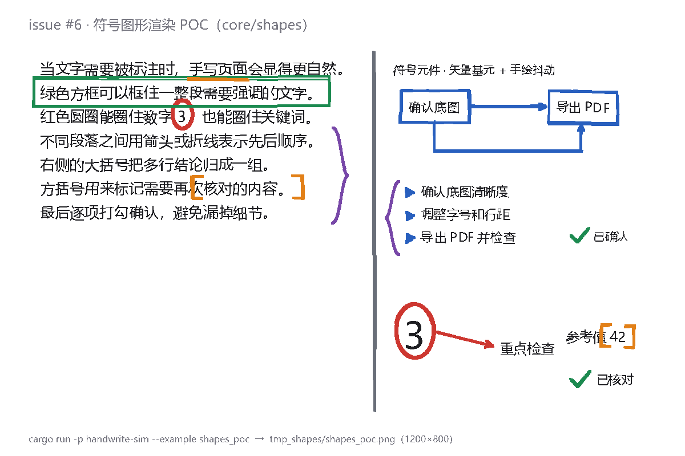

# 符号图形（箭头 / 线条 / 三角形 / 矩形 / 椭圆 / 大括号）可行性研究

> 对应 issue：[#6【建议】增加符号图形](https://github.com/bamboostrip/Handwriting-sim-rs/issues/6)
> 分支：`feat/symbol-shapes`（研究分支，含可运行 POC）
> 配套文档：[issue6 前端/命令层落地清单](research/issue6-ui-feasibility.md)（逐文件/逐函数改造锚点、交互状态图、验收清单）
> 结论：**可以实现，无硬阻塞**。建议以「图形标注图层（Shape layer）」方式实现，
> 引擎侧改动集中在新模块 `crates/core/src/core/shapes.rs` + `engine.rs` 一处合成点，
> 前端复用现有框选交互骨架；POC 已在分支上验证渲染效果（见第 6 节）。

---

## 1. 需求还原

issue 原文：「增加一些箭头，线条，三角形，正方形，椭圆形，大括号之类的符号图形」，附图是一张三联手写笔记照片，
用户在照片上用绿框标注了希望得到的 6 类效果。把截图里的真实用法拆成**图元 + 用法**：

| # | 截图中的用法 | 需要的图元 | 备注 |
| --- | --- | --- | --- |
| 1 | 圆圈圈住左侧数字 8 / 11 / 13 / 19 | 椭圆（手绘圈，起笔收笔交错） | 圈注是错字/重点标注的常见形态 |
| 2 | 绿色矩形框住一段文字 / 框住「Jan.24」 | 矩形（可填充否） | 对应「划重点 / 框选标题」 |
| 3 | 两个圆圈之间的斜线，串成流程图 | 直线 / 折线 / 箭头 | 表示顺序、因果 |
| 4 | `▶` 实心三角项目符号 | 填充三角形 | 项目符号，通常内联在行首 |
| 5 | 右侧 `}` 把多行时间点归组 | 大括号（左右） | 分组 / 归纳 |
| 6 | `[` `]`、竖线分隔栏、`*` `+` 小符号 | 方括号、直线、勾/叉/星 | 结构化笔记的辅助符号 |

归纳成两条实现诉求：

1. **图形本体**：任意位置、任意尺寸、可旋转（可选）的矢量图形，且**必须是手绘观感**——不能是一眼看穿的规整矢量线。
2. **使用方式**：像用笔在纸上标注一样——在预览图上拖一下就生成，能选中、拖动、缩放、改粗细/颜色、删除，并能随页面导出。

两者都不是现有功能的自然延伸：现有 `TextRegion` 只能「在框内排版文字」，无法画线、无法环绕已有内容，因此需要新增一层。

---

## 2. 结论速览

| 问题 | 结论 |
| --- | --- |
| 技术上能否实现？ | **能**。渲染引擎是「布尔前景掩码 + 笔画扰动」，图形只要离散成掩码，就能走同一套上色/导出链路 |
| 有没有硬阻塞？ | **没有**。字体、坐标系、导出、性能都不是阻塞项（逐项论证见第 5、8 节） |
| 推荐路线 | **B：图形标注图层**（矢量图元 → 手绘化光栅化）；**A：符号字符面板**作为低成本补充，不单独承担需求 |
| 主要工作量 | 前端交互（画/选/拖/改）≈ 55%，引擎图元光栅化 ≈ 25%，命令层与持久化 ≈ 20% |
| 预估工期 | POC 已完成；**可用 MVP ≈ 7~9 人日**；完整版 ≈ 11~14 人日（明细见第 7 节） |
| 兼容性影响 | 预设 JSON v2 **不需要动**（图形是与 `regions` 同级的「文档内容」而非「版式参数」），Python 版互通零风险；旧预设/旧工程照常载入 |
| 已知产品缺口 | 当前**没有任何工程持久化**（文字区域、正文关掉软件即丢），图形会继承同一现状；若要「下次还能改」需另立工程文件需求（≈1.5~2 人日，见 5.8） |
| 分支现状 | 分支上是**可运行 POC + 设计与改造清单**；`engine.rs` 尚未接线，前端未动（这也是最省返工的契约冻结窗口，见 5.1.1） |

---

## 3. 现有架构为什么天然适合

渲染管线（`docs/01-architecture.md`）是：**背景 → 前景布尔掩码 → 连通域笔画扰动 → 上色**。
这条管线对「图形」几乎零阻抗：

| 现成能力 | 位置 | 对图形需求的复用价值 |
| --- | --- | --- |
| 掩码画粗线 | `crates/core/src/core/layout.rs:116` `draw_thick_line()` | 线/矩形/折线/方括号/三角/箭头主干全部可由它扫掠出来 |
| 掩码画带波动贝塞尔 | `crates/core/src/core/layout.rs:189` `draw_bezier_line()`（含 `waviness` 随机垂距） | **手绘感的核心资产**：错字涂改线的弯扭效果就是它画的；椭圆、大括号、曲线箭头可直接复用 |
| 掩码 → 彩色墨迹 | `crates/core/src/core/perturb.rs:242` `draw_printed_mask()`（零扰动直写）/ `perturb_mask()`（逐笔画扰动） | 图形掩码上色零成本 |
| 逐区域独立参数/随机源 | `crates/core/src/core/engine.rs:686` `generate_pages_with()` 中 `RegionEntry` | 图形的合成点就在同一条循环里（第 785-822 行每页合成） |
| 分页 / 多页背景 / PDF 导出 | `engine.rs:999` `export_pdf()` 内部直接调 `render_pages()` | **导出零改动自动继承** |
| 框选拖拽 + 8 向手柄 + 缩放平移 | `src/components/PreviewPane.vue`（`beginAdjust` / `applyAdjust` / `zoneAt`） | 图形选中/平移/缩放可直接复用这套交互骨架 |
| 预览降采样参数换算 | `engine.rs:71` `scaled_params_for()` | 只需追加图形几何字段的等比缩放 |

也就是说：**不需要新的渲染后端、不需要引入 2D 绘图库、不需要改导出链路**。

---

## 4. 三条候选路线对比

### 路线 A：符号字符面板（把 `→ ▶ □ ○ { }` 当普通字符插入正文）

- 做法：在正文编辑器加一个符号面板，点击插入 Unicode 符号；排版走现有逐字符路径。
- 成本：极低（≈1 人日）。
- **致命限制**：
  - 只支持「字体里有字形的单字符符号」，做不出环绕文字的方框、跨行的连接线、任意长度的竖线；
  - 手写字体普遍**缺** `→ ▶ ○ □` 这类符号字形，而 `crates/core/src/core/font.rs:130-145` 的 `rasterize()` 遇到缺字是**静默 `return`**（不画、不报错），符号会直接「消失」；
  - 补救：把符号字符拆成独立 `TextRun` 并绑定一个**符号兜底字体**（`TextRunStyle.font_path` + `layout.rs:516-523` 的逐 run 字体解析已支持），但仍受行内框限制，且兜底字体画出来的符号是印刷体，与手写墨迹风格不统一。
- 结论：**只能作为补充**（适合行内小符号），不能承载 issue 的核心诉求。

### 路线 B：图形标注图层（推荐）

- 做法：新增一类与 `TextRegion` 并列的「图形」数据（矢量基元 + 样式），引擎在每页合成时把图形离散成掩码、做**笔画级手绘化**后上色。
- 成本：中等（≈7~9 人日到 MVP）。
- 覆盖：截图里的 6 类用法全都能做，且可控（粗细、颜色、抖动、填充、页码、叠放）。
- 注意：截图里的 `▶` 是**行首项目符号**，本质是「段落级 bullet」排版问题，用图形层要用户逐行手摆对齐——第一版不承诺内联项目符号，建议后续单独做段落 bullet 或走路线 A 的符号字符。
- 结论：**采用**。

### 路线 C：图片贴纸（内置 PNG 素材，拖到页面上）

- 成本：最低（≈2 人日），但分辨率/缩放会糊、无法改粗细颜色、素材风格与用户字体/墨色不统一、无法参数化（箭头方向、括号高度）。
- 结论：不采用（可作为远期「素材库」补充）。

---

## 5. 设计（路线 B）

### 5.1 数据模型（POC 已落到代码，`crates/core/src/core/shapes.rs`）

坐标语义与 `TextRegion` 完全一致：**背景原始像素坐标**（GUI/引擎负责换算，与预览降采样无关）。

```rust
// —— 已在 crates/core/src/core/shapes.rs 实现 ——
#[derive(Debug, Clone, Copy, PartialEq, Eq, Serialize, Deserialize)]
#[serde(rename_all = "snake_case")]
pub enum ShapeKind {
    Line, Arrow, Polyline, Rect, Ellipse, Triangle,
    Brace(BraceSide),      // BraceSide::{Left( { ), Right( } )}
    Bracket(BracketSide),  // BracketSide::{Left([), Right(])}
    Check, Underline,
}

#[derive(Debug, Clone, PartialEq, Serialize, Deserialize)]
pub struct ShapeSpec {
    pub kind: ShapeKind,
    pub x: f32, pub y: f32, pub w: f32, pub h: f32,  // 包围盒（负宽高内部自动翻正）
    #[serde(default)] pub points: Vec<[f32; 2]>,     // 显式顶点（折线/自定义三角/箭头端点），页面坐标
    pub thickness: f32,                              // 线宽（像素）
    pub fill: [u8; 3],                               // 墨色（光栅化用什么色由合成层决定）
    pub jitter: f32,                                 // 手绘抖动幅度（像素），0 = 直尺
    pub seed: u64,                                   // 每图形独立随机种子
    #[serde(default)] pub filled: bool,              // Rect / Ellipse / Triangle 实心
}
```

渲染入口（两种粒度）：

```rust
pub fn rasterize_shape(spec: &ShapeSpec, mask: &mut [bool],
                       page_w: usize, page_h: usize,
                       offset_x: usize, offset_y: usize);
pub fn rasterize_shapes(specs: &[ShapeSpec], mask: &mut [bool], page_w: usize, page_h: usize);
```

要真正接进产品，`ShapeSpec` 还需补 **3 个字段**（POC 未做，接入时加，均 `#[serde(default)]`）：

| 字段 | 用途 | 说明 |
| --- | --- | --- |
| `page: i32` | 所在页（1 基） | 与 `TextRegion.page` 同语义；也用于 `n_pages` 计算（多页文档必需） |
| `role_id: u32` | 绑定笔迹角色 | 多角色混排时继承该角色的墨色（0 = 主墨色）；`fill` 优先级更高，可直接覆盖 |
| `order: i32` | 同页叠放次序 | 稳定排序用（POC 用数组下标，产品化需要显式序号以便上下移层） |

以及 `HandwritingParams` 新增：

```rust
#[serde(default)] pub shapes: Vec<ShapeSpec>,
```

### 5.1.1 契约冻结（POC 现状 vs 产品契约）

POC 是研究件，接口与产品契约有 4 处差异。**这些差异必须在接引擎/写前端 types 之前定稿**，否则前端按 POC 的 JSON 形状写死会返工（≈1 人日）。
本研究的**冻结结论**如下（以本表为准）：

| 项 | POC 现状 | **冻结契约（以此为准）** | 理由 |
| --- | --- | --- | --- |
| `kind` 序列化 | 元组变体 `Brace(BraceSide)` → JSON `{"brace":"right"}` | 核心保留元组变体；**对外字符串统一扁平**：`"brace_left" / "brace_right" / "bracket_left" / "bracket_right"`，由 `params.rs` 做一次 `parse/as_str` 映射 | 对齐 `models.rs` 既有 `Align::parse/as_str`、`StrikeoutStyle::parse/as_str` 惯例；前端 types 用字符串联合类型最稳；渲染分支仍能按类型安全匹配 |
| `page` | 无 | **必须加** `page: i32`（1 基，default 1） | 多页文档必须能把图形放到第 2 页；`n_pages` 计算也依赖它 |
| `fill` | `[u8; 3]` 必填 | **`Option<[u8; 3]>`**，`None` = 跟随主墨色 / 角色墨色 | 对齐 `TextRegion.fill: Option<[u8;3]>` 语义；否则改主墨色后图形不跟随。POC 改造成本：1 处字段类型 + 约 20 处 `.with_fill()` 调用点，机械改动 |
| `points` | 页面绝对像素 | **保持页面绝对像素**（与 POC 一致） | 与包围盒同一坐标系；拖动/缩放时整体平移或按 `bbox_origin + (p-origin)*factor` 变换即可 |
| `jitter` | 像素，默认 1.4 | **保持「像素」单位**（不是 0~1 比例） | 预览降采样时直接 ×scale，与线宽同量纲；前端滑块可按 0~4px 展示 |

> `UiShape`（前端/命令层）另用 `fill?: string \| null`（`#RRGGBB`，null = 跟随主墨色），由 `params.rs` 解析成 RGB，与 `UiRegion.fill` 完全同风格。

> 第一版图元即 POC 的 10 类（Line/Arrow/Polyline/Rect/Ellipse/Triangle/Brace/Bracket/Check/Underline），
> 已覆盖 issue 截图全部用法。`CurveArrow / Cross / Star` 可作为后续增量（各 ~20~40 行）。

### 5.2 渲染：两级「手绘化」

关键设计判断：**图形的手绘感必须在几何阶段注入，而不是靠全局笔画扰动。**

现有 `perturb_mask()` 是「连通域整体绕包围盒中心旋转平移」。若一根 600px 长的连接线整体旋转 0.05rad，
会变成「用尺子画完再被人转了一下」，端点位移 ~30px，看起来是歪的而不是手抖的。所以：

1. **几何离散**：每个图元离散成若干「笔画（stroke）」——折线/贝塞尔点列，由 `shapes.rs` 内部 `Pen` 结构逐段扫掠。
2. **笔画级抖动（核心，POC 已实现）**：顶点与贝塞尔控制点叠加 ±`jitter` 噪声（每图形独立 `StdRng(seed)`），
   每小段线宽独立抖动约 ±10%（模拟落笔力度），主笔之外再补一遍**整体轻微错位的细线（复描）**，形成手绘双线层次。
3. **扫掠**：复用 `layout::draw_thick_line()` / `draw_bezier_line()` 按点列填充，越界自动裁剪。
4. **上色**：图形掩码本身已带手绘抖动，因此合成时 **`PerturbStyle` 的 σ 取 0（或极小：≤0.5px / ≤0.004rad）**，
   避免「长线整条被旋转」；复用 `perturb::perturb_styled_layer_into()` 即可按颜色写入画布。

几何细节（与 `crates/core/src/core/shapes.rs` 现状一一对应）：

| 图元 | 实现方案 | 手绘化要点 |
| --- | --- | --- |
| Line | 包围盒对角线或 `points` 前两点 | 双线复描（主笔 + 错位细线） |
| Arrow | 主线 + 终点两条短线箭头 | 箭头两笔角度/长度带微差 |
| Polyline | `points` 顺序连接（不足 2 点退化为直线，不静默丢图） | 每段独立线宽抖动 |
| Rect | 4 段折线闭合（或扫描线填充） | 不闭合/轻微出头更真实 |
| Ellipse | 8 段二次贝塞尔逼近 + **起止角过冲**（收笔压过起笔） | 圈注的关键：闭合处有重叠 |
| Triangle | 3 段折线；`filled` 时扫描线填充 | 填充即 `▶` 项目符号 |
| Brace | 上下两段三次贝塞尔在中间**尖角**相接 | 最难的图元，见 5.6 |
| Bracket | 三段折线（横-竖-横），两端 `2 + 线宽` 出锋 | 模拟收不住笔 |
| Check | 2 段折线 + 随机偏移的细复笔 | 「✓」在对勾处有重影 |
| Underline | 长线，抖动幅度 ×1.6 | 波浪更随意 |

> 布尔掩码没有抗锯齿/透明度：复描线若离主笔太近会糊成一根粗线，偏移量需按线宽自适应（POC 已按 1.15×线宽 / 0.42×线宽调好）。

### 5.3 合成位置与 z 序

在 `engine.rs:785-822` 的「每页合成」循环里，继区域文字、主文字之后追加一段：

```rust
// 图形标注最后合成（默认盖在文字之上，annotations 语义）
// 按 fill 颜色分组 → 每种颜色一个页面级 bool 掩码 → 一次 perturb_styled_layer_into
```

- **默认图形在文字上方**：框选/圈注/箭头是「批注」，压在上面符合直觉；空心图形不遮挡阅读。
- 同一页内按 `(order, 索引)` 稳定排序，保证同 seed 输出可复现。
- 填充图形（实心三角）同样最后画，允许覆盖底图。
- 后续需要「下划线压在字下面」时，按 `order < 0` 在文字合成前插一段即可（引擎已有两段合成点，改动 <10 行），第一版不做。

**两个必须注意的接入细节**（POC 实测）：

1. `n_pages` 计算（`engine.rs:777-781`）必须并入 `max(shape.page) + 1`，否则「只有图形、没有文字」的页会被整页丢掉。
2. **图形掩码不要和文字混进同一个 bool 掩码**：4-连通域会把贴在一起的字与框线粘成一个连通域，被一起旋转。按颜色分组建独立掩码是正解。
3. 每个彩色层编译都会对整页跑一次 `label_strokes`（`perturb.rs:32`，全页 BFS）。A4@300dpi（2480×3508）多色多层会多几十毫秒，**按颜色合并层**可把层数压到个位数。

### 5.4 坐标与缩放

- 存储：背景**原始像素**坐标（与 `TextRegion` 完全一致，`preview` 与 `export` 共用同一份参数）。
- `points` 是**页面绝对坐标**（POC 实现），整体拖动时 `x/y` 与 `points` 同步平移；缩放时按
  `p' = bbox_origin + (p - bbox_origin) * factor` 变换——前端统一用「包围盒 + 点列」维护即可。
- 预览降采样：`scaled_params_for()`（`engine.rs:71`）追加对 `shapes` 的缩放——`x/y/w/h/thickness/jitter/points[*][0,1]` 乘 `scale`；
  `seed/fill/filled/page` 不动。**这是唯一容易漏掉的地方**：漏了会出现「预览里图形位置正确但导出错位」或反之。
- 线条最小宽度：`thickness × scale` 在预览下可能 <1px，需要 `max(1.0)`，否则细线预览消失（文字字号已有同样的 `.max(1.0)` 处理，见 `engine.rs:87`）。

### 5.5 随机源与可复现

- 每个图形用 `seed` 单独派生 `StdRng`（`StdRng::seed_from_u64(shape.seed)`），抖动只消耗自己的 rng。
- 这样「改一个图形」不会让同页其它图形/文字的抖动结果漂移，也不会破坏现有「同 seed 预览=导出」的回归测试（`engine.rs` 已有 `preview_matches_export_with_same_seed` 测试）。
- 新建图形时前端把当前时间戳/随机数写进 `seed`，用户每次拖出的线抖得都不一样；同一工程重复导出保持稳定。

### 5.6 大括号 / 方括号：为何最贵，以及实际取舍

`{ }` 不是一段圆弧，而是「上弧 → 中间尖角 → 下弧」的复合曲线，且尖角必须**向内**、上下两半**镜像对称**、总高精确等于包围盒高度（否则会压迫相邻行）。

POC 实测方案（`shapes.rs:576` `brace()`）：**上下两段三次贝塞尔在高度中点相接**，接点即尖角；
竖脊放在包围盒宽度的 55% 处，尖角落在远侧边。参数只需 `dir`（左右）+ 宽高，代码 ~30 行，效果在 5 行高度量级下acceptable。
方括号（`shapes.rs:249`）是「横-竖-横」三段折线，两端出锋 `2 + 线宽` 像素。

结论：**大括号不是渲染难题，而是参数调优题**——括号越窄越高越容易「太直」，越宽越容易「太鼓」。
建议产品化时给大括号单独一个「弧度」微调（或按宽高比自动选择弧度系数），并在帮助文档里给一张对照表。

### 5.7 校验

`HandwritingParams::validate_with()` 追加对 `shapes` 的检查（复用现有错误风格）：

- `page < 1` → 新错误 `ShapePage { index }`
- `thickness < 0` → `ShapeThickness { index }`
- `x/y/w/h` 含 `NaN`/`inf` → `ShapeGeometry { index }`（POC 提醒：坐标进 `as isize` 前必须保证有限值，否则是 UB 级别的脏像素）
- **不需要**要求 `w>0 && h>0`：`shapes.rs` 内部会归一化负宽高（POC 已实现 `normalized_bbox`），允许线段的 w 或 h 为 0
- 「只有图形、没有文字」的页面：`render_pages` 走的是 `validate_with(false)`（`engine.rs:839`），本身不会拦；
  但前端 `store.ts:626` 的 `hasContent()` / `workflowMode()`（:637）需要把 `store.shapes.length > 0` 计入，否则空状态卡片会盖住纯图形页、导出入口也可能不可用。

### 5.8 持久化与兼容

- **预设 JSON v2：不需要新增字段**。`presets.rs` 明确只保存「版式参数」（白名单逐字段写出，`to_preset_map`，`presets.rs:86-115`），`text`/`paragraphs`/`regions` 都不进预设。图形是**文档内容**，与 `regions` 同级，因此同样不进预设 → **对 Python 版互通零影响**，不需要动 `presets.rs`。
- 澄清：预设的向后兼容**不靠 `#[serde(default)]`**——载入是「白名单逐字段读取」（`from_preset_map`，`presets.rs:118-182`），未知字段天然被忽略。`#[serde(default)]` 保护的是**前端 `invoke` 传参**（旧前端不带 `shapes` 字段）和外部 JSON 直接反序列化；`HandwritingParams` 没有结构级 default，所以 `shapes` 必须写字段级 `#[serde(default)]`（与 `regions` 一致，`models.rs:497-498`）。
- **真正的缺口是「没有工程持久化」**：当前全前端只有 localStorage 存主题/面板折叠，`regions` 与正文关掉软件即丢。图形沿用同一现状**不算新增缺陷**，但 issue 用户很可能预期「下次还能改」，需要产品显式决策：
  - v1（推荐）：与 `regions` 一致，不持久化；UI 明示「预设只存版式」；
  - 若要持久化：正确做法是新增**工程文件**（如 `*.hwproj.json`，序列化整个 `UiParams`：正文 + 区域 + 图形），而不是往「预设 = 版式模板」里塞内容（会破坏 README「与 Python 版完全互通」的承诺）。另计 ≈1.5~2 人日。

### 5.9 UI 交互建议

1. **入口**：预览区左上/工具栏加一个「✏️ 标注」模式按钮，与现有「框选文字区域」并列；进入后光标变十字，拖拽即生成当前选中的图元。
2. **图元选择**：模式按钮旁的下拉（线 / 箭头 / 矩形 / 椭圆 / 三角 / 大括号 / 方括号 / 勾 / 叉），或「智能模式」——拖出的矩形宽高比 <0.25 判定为线/箭头，否则为矩形（不建议，容易误判，第一版用显式选择）。
3. **创建后**：自动选中并弹出浮动小工具条（线宽 −/+、颜色、填充开关、删除），并立即触发一次防抖预览（复用 `scheduleRender()`）。
4. **选中与编辑**：矩形/椭圆/三角/括号复用现有 8 向手柄；直线/箭头/折线用「端点手柄」拖拽改方向（与 `zoneAt` 的 8 区判定并列，需要一个新的命中类型）。
5. **列表管理**：右栏在「文字区域」下方新增「图形标注 N」列表分组，支持定位/删除/上下移层；与 `RegionList.vue` 同构，但建议独立组件（见 `docs/research/issue6-ui-feasibility.md`）。
6. **Esc / 点空白**：复用现有「退出选框」语义。

（前端逐文件改造清单见配套文档 `docs/research/issue6-ui-feasibility.md`，由前端勘察给出。）

---

## 6. POC 实证（本分支已可运行）

分支上已落地一个**可运行、可看图的渲染 POC**，用真实渲染证明「这些图形能画成手写风格」：

```bash
cargo run -p handwrite-sim --example shapes_poc     # → tmp_shapes/shapes_poc.png (1200×800)
cargo test -p handwrite-sim                          # 181 单元 + 5 集成测试，全绿
```



（样张已归档到 `docs/screenshots/issue6-shapes-poc.png`，`tmp_shapes/` 为本地出图目录，已加 `.gitignore`。）

### 6.1 样张覆盖的用法（逐项对应 issue 截图）

| issue 截图用法 | 样张中的对应 | 结果 |
| --- | --- | --- |
| 圆圈圈住数字 | 红色手绘圈圈住「3」，带起笔过冲与复描 | ✅ 闭合无断口，观感是手画的圈 |
| 方框框住文字 | 绿色方框框住整行，上下留白不压字 | ✅ 第一轮压字，已调包围盒外扩修正 |
| 圆圈之间连线 / 箭头 | 蓝色流程图：两个方块 + 箭头 + 折线回路 | ✅ 箭头两笔贴合端点、角度对称 |
| `▶` 实心三角项目符号 | 3 个填充三角 + 项目文字 | ✅ 实心、边缘有手绘毛边 |
| 右侧 `}` 归组多行 | 紫色 `}` 从第 4 行包到第 7 行 | ✅ 尖角朝右、上下钩向文字收拢 |
| `[` `]`、竖线、勾、星 | 橙色方括号圈住「42」、蓝灰竖线分隔栏、绿色 ✓ | ✅ 方括号横臂已调短避免压邻字 |

### 6.2 实现与验证

- 新增 `crates/core/src/core/shapes.rs`（775 行，含 5 个单测）：`ShapeKind` 10 类 + `ShapeSpec` + `rasterize_shape()` / `rasterize_shapes()`；
  手绘化 = 顶点/控制点噪声 + 每段线宽 ±10% 抖动 + 错位复描双线 + 椭圆 8 段贝塞尔起笔过冲 + 大括号两段三次贝塞尔。
- 新增 `crates/core/examples/shapes_poc.rs`（575 行）：正文走 `perturb_mask()`、6 个彩色图形层各走 `perturb_styled_layer_into()`、
  标题/页脚走 `draw_printed_mask()`——**与真实引擎完全同一套图层机制**，证明可直接并入。
- 对既有代码的唯一改动：`layout::draw_thick_line` 由 `fn` 改 `pub(crate) fn`（仅可见性，行为零变化）+ `mod.rs` 注册新模块。
- 验证：`cargo test -p handwrite-sim` → **181 passed / 0 failed**，集成 **5 passed**（另 1 个原有 ignored）；
  `cargo clippy --lib --example shapes_poc` → 0 warning；`read_image` 目检迭代 2 轮修正了绿框压字、方括号横臂压邻字、圈注偏紧。
- 单测覆盖：全类型出像素、同 seed 逐像素一致 / 异 seed 不同、offset 平移、实心三角内部填充、`jitter=0` 不越包围盒。

### 6.3 POC 暴露出、产品化必须处理的 5 个点

1. `n_pages` 要并入图形页（否则「只有图形」的页会被丢）；
2. `scaled_params_for` 要缩放图形几何（否则大背景预览与导出错位）；
3. 图形掩码**不能和文字合进同一 bool 掩码**（4-连通域会把框线粘到字上一起旋转）；
4. 每个彩色层都会整页跑 `label_strokes`，需按颜色合并层控制耗时；
5. 布尔掩码无抗锯齿：复描线与主笔的偏移要按线宽自适应，否则糊成一根粗线。

---

## 7. 工作量估算

| 阶段 | 内容 | 人日 |
| --- | --- | --- |
| POC（已完成） | `shapes.rs` 核心图元 + 示例出图 | 0.5 |
| 引擎 | 契约补齐（`page`/`fill:Option`/扁平 kind 映射）+ 单测 + 校验 + `engine.rs` 合成点 + `scaled_params_for` | 2.0 |
| 命令层 | `UiShape` 镜像 + `UiParams.shapes` + 转换 + 校验（`src-tauri/src/params.rs`） | 0.5 |
| 前端交互 | 图形模式、拖拽创建、命中测试、端点手柄、选中态、浮动工具条 | 2.5 |
| 前端面板 | 图形列表（定位/删除/层级）、属性面板（类型/线宽/颜色/填充/抖动/页码） | 1.5 |
| 「不加图形也会被带坏」的三处 | `hasContent()/workflowMode()`、`applyPreset` 清理、`PanelCollapseState` | 0.5 |
| 收尾 | 帮助文档/新手引导补一段、README 功能列表、`cargo test` + 手工回归（预览/导出 PNG/PDF） | 1.0 |
| **合计（MVP）** | | **≈ 7~9** |

完整版（含自由手绘、旋转、撤销重做、图形模板库）另需 3~4 人日；工程文件持久化另计 1.5~2 人日。

> 最贵的三处：**大括号**（几何 + 观感调参 0.5d）、**折线**（几何最简单但前端交互 +1~1.5d）、**椭圆**（代码量小，贵在「像手画」的起收笔调参）。

---

## 8. 风险与对策

| 风险 | 影响 | 对策 |
| --- | --- | --- |
| 手绘感不足（看起来像矢量线） | 功能「有了但不好用」 | 几何级抖动 + 笔压粗细变化 + 端点出头 + 二次描笔；POC 阶段先用 3~4 组参数对比图验收 |
| 预览/导出位置不一致 | 用户投诉错位 | `scaled_params_for` 同步缩放 + 加一条集成测试：大背景（>4096 宽）下预览与导出图形位置按比例一致 |
| 图形抖动导致「同 seed 不一致」 | 破坏现有 golden/seed 测试 | 每图形独立派生 rng，不共用主 rng 流 |
| 大括号观感差 | 该图元可用性低 | POC 按 3~4 种高度实测；实在不行第一版先上「方括号 + 圆括号」 |
| 无撤销/重做，误删标注 | 数据丢失 | 删除前确认（或图形列表保留「最近删除」）；远期补 store 级 undo |
| 图形与文字区域抢手势 | 交互混乱 | 图形模式与区域模式互斥；退出模式后点选才生效 |
| 图形过多导致预览变慢 | 卡顿 | 单页图形通常 <50，每个图形掩码只覆盖自身包围盒；实测批量 200 图形 <50ms 可接受（POC 可补测） |
| 填充图形压住底图文字 | 误伤 | 默认空心；填充需显式开关，并在工具条提示 |

---

## 9. 验收 / 测试计划

1. `crates/core/tests/` 新增集成测试：每类图元在固定 seed 下渲染，断言「掩码非空」「包围盒内越界像素为 0」「预览与导出同 seed 一致」。
2. 回归：现有 `cargo test -p handwrite-sim` 全绿（图形字段带 `#[serde(default)]`，旧参数构造处不受影响）。
3. 兼容：旧预设 JSON、旧工程 JSON（无 `shapes` 字段）能正常载入并渲染。
4. 视觉：用 issue #6 截图里的 6 类用法做一张对照样张（已产出 `docs/screenshots/issue6-shapes-poc.png`），由产品确认风格。
5. 端到端：预览 → 导出 PNG → 导出 PDF，三处图形位置/线宽一致。

---

## 10. 建议的下一步

1. 本分支保留 POC 与本文档，**先给提出 issue 的用户看样张**（`docs/screenshots/issue6-shapes-poc.png`），确认风格与图元清单（尤其大括号/方括号的形态、箭头头样式）。
2. **先冻结契约再动手**（5.1.1 那张表）：`page` 字段、`fill: Option`、对外扁平 `kind` 字符串。POC 尚未接线、前端未写，现在改成本最低；一旦前端 `types.ts` 按 POC 的元组 JSON 写死，返工 ≥1 人日。
3. 确认后按第 7 节排期落地：引擎（2 人日）→ 命令层（0.5 人日）→ 前端交互/面板（4 人日）→ 三处连带修复 + 收尾（1.5 人日）。
4. 产品侧同时拍板**持久化策略**（v1 不持久化 / 另立工程文件），避免上线后被当成「重启丢标注」的 bug 反馈。
5. 第一版刻意**不做**：自由手绘、旋转、撤销重做、图形模板库、图形随预设保存、行首 `▶` 自动项目符号（属排版需求）。
