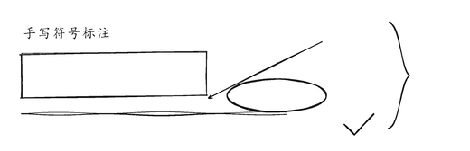
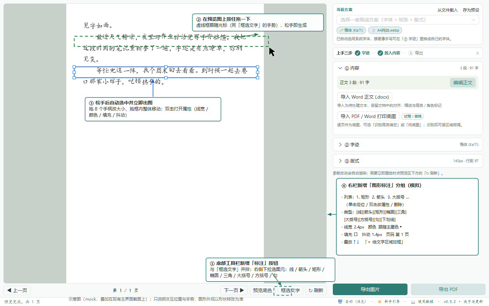
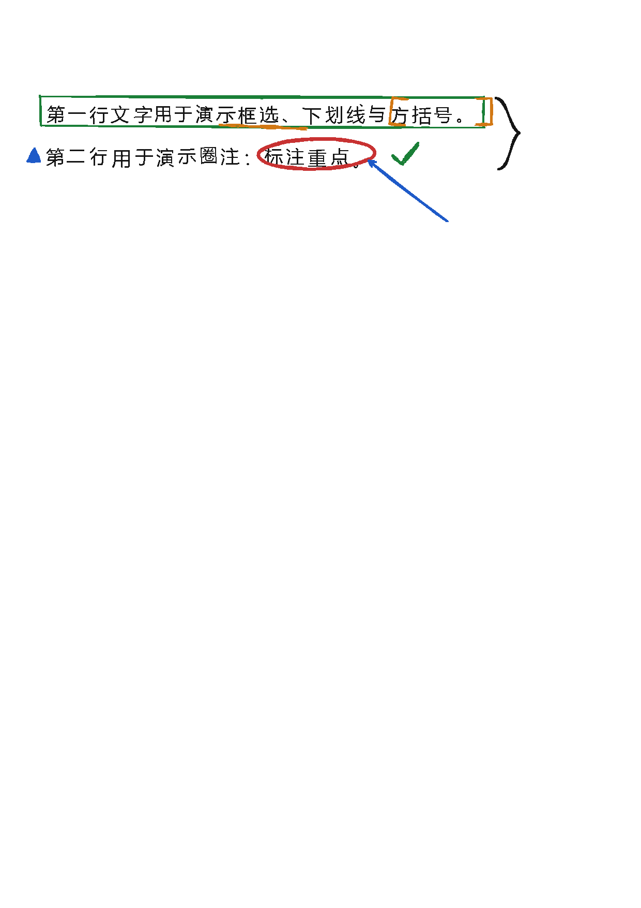

# 符号图形（箭头 / 线条 / 三角形 / 矩形 / 椭圆 / 大括号）可行性研究

> 对应 issue：[#6【建议】增加符号图形](https://github.com/bamboostrip/Handwriting-sim-rs/issues/6)
> 分支：`feat/symbol-shapes`（研究分支，含可运行 POC）
> 配套文档：[issue6 前端/命令层落地清单](research/issue6-ui-feasibility.md)（逐文件/逐函数改造锚点、交互状态图、验收清单）、
> [issue6 图形标注 MVP 冻结契约](research/issue6-shape-mvp-contract.md)（实施基线：字段 / id 表 / 合成方式）
> 结论：**可以实现，无硬阻塞**，且 **MVP 已在本分支实现**：建议以「图形标注图层（Shape layer）」方式实现，
> 引擎侧改动集中在新模块 `crates/core/src/core/shapes.rs` + `engine.rs` 一处合成点，
> 前端复用现有框选交互骨架。渲染效果与真实引擎链路均有可复现样张（见第 6 节）。

---

## 1. 需求还原

issue 原文：「增加一些箭头，线条，三角形，正方形，椭圆形，大括号之类的符号图形」，附图是一张三联手写笔记照片，
用户在照片上用绿框标注了希望得到的 6 类效果。把截图里的真实用法拆成**图元 + 用法**：

| # | 截图中的用法 | 需要的图元 | 备注 |
| --- | --- | --- | --- |
| 1 | 圆圈圈住左侧数字 8 / 11 / 13 / 19 | 椭圆（手绘圈，起笔收笔交错） | 圈注是错字/重点标注的常见形态 |
| 2 | 绿色矩形框住一段文字 / 框住「Jan.24」 | 矩形（可填充否） | 对应「划重点 / 框选标题」 |
| 3 | 两个圆圈之间的斜线，串成流程图 | 直线 / 折线 / 箭头 | 表示顺序、因果 |
| 4 | `▶` 实心三角项目符号 | 填充三角形 | 项目符号，通常内联在行首 |
| 5 | 右侧 `}` 把多行时间点归组 | 大括号（左右） | 分组 / 归纳 |
| 6 | `[` `]`、竖线分隔栏、`*` `+` 小符号 | 方括号、直线、勾/叉/星 | 结构化笔记的辅助符号 |

归纳成两条实现诉求：

1. **图形本体**：任意位置、任意尺寸、可旋转（可选）的矢量图形，且**必须是手绘观感**——不能是一眼看穿的规整矢量线。
2. **使用方式**：像用笔在纸上标注一样——在预览图上拖一下就生成，能选中、拖动、缩放、改粗细/颜色、删除，并能随页面导出。

两者都不是现有功能的自然延伸：现有 `TextRegion` 只能「在框内排版文字」，无法画线、无法环绕已有内容，因此需要新增一层。

---

## 2. 结论速览

| 问题 | 结论 |
| --- | --- |
| 技术上能否实现？ | **能**。渲染引擎是「布尔前景掩码 + 笔画扰动」，图形只要离散成掩码，就能走同一套上色/导出链路 |
| 有没有硬阻塞？ | **没有**。字体、坐标系、导出、性能都不是阻塞项（逐项论证见第 5、8 节） |
| 推荐路线 | **B：图形标注图层**（矢量图元 → 手绘化光栅化）；**A：符号字符面板**作为低成本补充，不单独承担需求 |
| 主要工作量 | 前端交互（画/选/拖/改）≈ 55%，引擎图元光栅化 ≈ 25%，命令层与持久化 ≈ 20% |
| 预估工期 | POC 已完成；**可用 MVP ≈ 7~9 人日**；完整版 ≈ 11~14 人日（明细见第 7 节） |
| 兼容性影响 | 预设 JSON v2 **不需要动**（图形是与 `regions` 同级的「文档内容」而非「版式参数」），Python 版互通零风险；旧预设/旧工程照常载入 |
| 已知产品缺口 | 当前**没有任何工程持久化**（文字区域、正文关掉软件即丢），图形会继承同一现状；若要「下次还能改」需另立工程文件需求（≈1.5~2 人日，见 5.8） |
| 分支现状 | **MVP 已实现并验证**：core 渲染 / 命令层 / 前端交互与面板全部落地，两条样张可复现，`cargo test` 两 crate 与 `pnpm build` 全绿；未做的是折线 UI、自由手绘、旋转、撤销重做、工程持久化（见 §10） |

---

## 3. 现有架构为什么天然适合

渲染管线（`docs/01-architecture.md`）是：**背景 → 前景布尔掩码 → 连通域笔画扰动 → 上色**。
这条管线对「图形」几乎零阻抗：

| 现成能力 | 位置 | 对图形需求的复用价值 |
| --- | --- | --- |
| 掩码画粗线 | `crates/core/src/core/layout.rs:116` `draw_thick_line()` | 线/矩形/折线/方括号/三角/箭头主干全部可由它扫掠出来 |
| 掩码画带波动贝塞尔 | `crates/core/src/core/layout.rs:189` `draw_bezier_line()`（含 `waviness` 随机垂距） | **手绘感的核心资产**：错字涂改线的弯扭效果就是它画的；椭圆、大括号、曲线箭头可直接复用 |
| 掩码 → 彩色墨迹 | `crates/core/src/core/perturb.rs:242` `draw_printed_mask()`（零扰动直写）/ `perturb_mask()`（逐笔画扰动） | 图形掩码上色零成本 |
| 逐区域独立参数/随机源 | `crates/core/src/core/engine.rs:686` `generate_pages_with()` 中 `RegionEntry` | 图形的合成点就在同一条循环里（第 785-822 行每页合成） |
| 分页 / 多页背景 / PDF 导出 | `engine.rs:999` `export_pdf()` 内部直接调 `render_pages()` | **导出零改动自动继承** |
| 框选拖拽 + 8 向手柄 + 缩放平移 | `src/components/PreviewPane.vue`（`beginAdjust` / `applyAdjust` / `zoneAt`） | 图形选中/平移/缩放可直接复用这套交互骨架 |
| 预览降采样参数换算 | `engine.rs:71` `scaled_params_for()` | 只需追加图形几何字段的等比缩放 |

也就是说：**不需要新的渲染后端、不需要引入 2D 绘图库、不需要改导出链路**。

---

## 4. 三条候选路线对比

### 路线 A：符号字符面板（把 `→ ▶ □ ○ { }` 当普通字符插入正文）

- 做法：在正文编辑器加一个符号面板，点击插入 Unicode 符号；排版走现有逐字符路径。
- 成本：极低（≈1 人日）。
- **致命限制**：
  - 只支持「字体里有字形的单字符符号」，做不出环绕文字的方框、跨行的连接线、任意长度的竖线；
  - 手写字体普遍**缺** `→ ▶ ○ □` 这类符号字形，而 `crates/core/src/core/font.rs:130-145` 的 `rasterize()` 遇到缺字是**静默 `return`**（不画、不报错），符号会直接「消失」；
  - 补救：把符号字符拆成独立 `TextRun` 并绑定一个**符号兜底字体**（`TextRunStyle.font_path` + `layout.rs:516-523` 的逐 run 字体解析已支持），但仍受行内框限制，且兜底字体画出来的符号是印刷体，与手写墨迹风格不统一。
- 结论：**只能作为补充**（适合行内小符号），不能承载 issue 的核心诉求。

### 路线 B：图形标注图层（推荐）

- 做法：新增一类与 `TextRegion` 并列的「图形」数据（矢量基元 + 样式），引擎在每页合成时把图形离散成掩码、做**笔画级手绘化**后上色。
- 成本：中等（≈7~9 人日到 MVP）。
- 覆盖：截图里的 6 类用法全都能做，且可控（粗细、颜色、抖动、填充、页码、叠放）。
- 注意：截图里的 `▶` 是**行首项目符号**，本质是「段落级 bullet」排版问题，用图形层要用户逐行手摆对齐——第一版不承诺内联项目符号，建议后续单独做段落 bullet 或走路线 A 的符号字符。
- 结论：**采用**。

### 路线 C：图片贴纸（内置 PNG 素材，拖到页面上）

- 成本：最低（≈2 人日），但分辨率/缩放会糊、无法改粗细颜色、素材风格与用户字体/墨色不统一、无法参数化（箭头方向、括号高度）。
- 结论：不采用（可作为远期「素材库」补充）。

---

## 5. 设计（路线 B）

### 5.1 数据模型（POC 已落到代码，`crates/core/src/core/shapes.rs`）

坐标语义与 `TextRegion` 完全一致：**背景原始像素坐标**（GUI/引擎负责换算，与预览降采样无关）。

```rust
// —— 已在 crates/core/src/core/shapes.rs 实现 ——
#[derive(Debug, Clone, Copy, PartialEq, Eq, Serialize, Deserialize)]
#[serde(rename_all = "snake_case")]
pub enum ShapeKind {
    Line, Arrow, Polyline, Rect, Ellipse, Triangle,
    Brace(BraceSide),      // BraceSide::{Left( { ), Right( } )}
    Bracket(BracketSide),  // BracketSide::{Left([), Right(])}
    Check, Underline,
}

#[derive(Debug, Clone, PartialEq, Serialize, Deserialize)]
pub struct ShapeSpec {
    pub kind: ShapeKind,
    pub x: f32, pub y: f32, pub w: f32, pub h: f32,  // 包围盒（负宽高内部自动翻正）
    #[serde(default)] pub points: Vec<[f32; 2]>,     // 显式顶点（折线/自定义三角/箭头端点），页面坐标
    pub thickness: f32,                              // 线宽（像素）
    pub fill: [u8; 3],                               // 墨色（光栅化用什么色由合成层决定）
    pub jitter: f32,                                 // 手绘抖动幅度（像素），0 = 直尺
    pub seed: u64,                                   // 每图形独立随机种子
    #[serde(default)] pub filled: bool,              // Rect / Ellipse / Triangle 实心
}
```

渲染入口（两种粒度）：

```rust
pub fn rasterize_shape(spec: &ShapeSpec, mask: &mut [bool],
                       page_w: usize, page_h: usize,
                       offset_x: usize, offset_y: usize);
pub fn rasterize_shapes(specs: &[ShapeSpec], mask: &mut [bool], page_w: usize, page_h: usize);
```

接入时的**字段取舍（已定稿，见 §5.1.1）**：

| 字段 | 状态 | 说明 |
| --- | --- | --- |
| `page: i32` | ✅ 已实现（`#[serde(default)]`，默认 1） | 与 `TextRegion.page` 同语义；`n_pages` 由最大页码决定，且有上限校验（2000） |
| `role_id: u32` | ❌ 未采用（MVP） | 多角色墨色继承属完整版；当前 `fill: None` 一律跟随**主墨色**。加上它只需一个字段 + 合成处取角色色 |
| `order: i32` | ❌ 未采用（改用数组顺序） | 逐图形合成让「数组顺序 = 叠放顺序」成立，列表 ↑↓ 直接改数组，无需显式序号 |

以及 `HandwritingParams` 新增：

```rust
#[serde(default)] pub shapes: Vec<ShapeSpec>,
```

### 5.1.1 契约冻结（POC 现状 vs 产品契约）

POC 是研究件，接口与产品契约有 4 处差异。**这些差异必须在接引擎/写前端 types 之前定稿**，否则前端按 POC 的 JSON 形状写死会返工（≈1 人日）。
本研究的**冻结结论**如下（以本表为准）：

| 项 | POC 现状 | **冻结契约（以此为准）** | 理由 |
| --- | --- | --- | --- |
| `kind` 序列化 | 元组变体 `Brace(BraceSide)` → JSON `{"brace":"right"}` | 核心保留元组变体；**对外字符串统一扁平**：`"brace_left" / "brace_right" / "bracket_left" / "bracket_right"`，由 `params.rs` 做一次 `parse/as_str` 映射 | 对齐 `models.rs` 既有 `Align::parse/as_str`、`StrikeoutStyle::parse/as_str` 惯例；前端 types 用字符串联合类型最稳；渲染分支仍能按类型安全匹配 |
| `page` | 无 | **必须加** `page: i32`（1 基，default 1） | 多页文档必须能把图形放到第 2 页；`n_pages` 计算也依赖它 |
| `fill` | `[u8; 3]` 必填 | **`Option<[u8; 3]>`**，`None` = 跟随主墨色 / 角色墨色 | 对齐 `TextRegion.fill: Option<[u8;3]>` 语义；否则改主墨色后图形不跟随。POC 改造成本：1 处字段类型 + 约 20 处 `.with_fill()` 调用点，机械改动 |
| `points` | 页面绝对像素 | **保持页面绝对像素**（与 POC 一致） | 与包围盒同一坐标系；拖动/缩放时整体平移或按 `bbox_origin + (p-origin)*factor` 变换即可 |
| `jitter` | 像素，默认 1.4 | **保持「像素」单位**（不是 0~1 比例） | 预览降采样时直接 ×scale，与线宽同量纲；前端滑块可按 0~4px 展示 |

> `UiShape`（前端/命令层）另用 `fill?: string \| null`（`#RRGGBB`，null = 跟随主墨色），由 `params.rs` 解析成 RGB，与 `UiRegion.fill` 完全同风格。

> 第一版图元即 POC 的 10 类（Line/Arrow/Polyline/Rect/Ellipse/Triangle/Brace/Bracket/Check/Underline），
> 已覆盖 issue 截图全部用法。`CurveArrow / Cross / Star` 可作为后续增量（各 ~20~40 行）。

### 5.2 渲染：笔触模型（为什么早期版本"像打印"）

关键设计判断：**图形的手绘感必须在几何阶段注入，而不是靠全局笔画扰动。**

现有 `perturb_mask()` 是「连通域整体绕包围盒中心旋转平移」。若一根 600px 长的连接线整体旋转 0.05rad，
会变成「用尺子画完再被人转了一下」，端点位移 ~30px，看起来是歪的而不是手抖的。所以手绘感由 `shapes.rs`
内部的 `Pen` 逐笔画生成。**第一版只做了顶点抖动，实际效果被用户指出"像打印的机器符号"**——
根因是：全程等宽、边缘几何干净、长线基本笔直。现在的笔触模型有 5 个层次：

| # | 手法 | 作用 |
| --- | --- | --- |
| 1 | **笔压（pressure）** | 每段沿长度方向平滑变宽变窄：起笔/收笔收细（taper 30~45%）、行笔中段最粗，叠加低频力度起伏（±28%）。**这是最关键的一条**——等宽线是"打印感"的头号来源 |
| 2 | **摆动（arch + waves）** | 直线不再是几何直线：整体轻微弓起（≤4px）+ 2.5 个周期的小波浪（幅度随 `jitter` 与笔画长度）；长线摆动更明显，短线几乎笔直 |
| 3 | **转角过头/欠笔** | 折线每段两端沿方向随机延伸（≤`min(1.6×线宽, 5%边长)`），使矩形/三角/括号的转角出现**交叉或缝隙**，而不是数字化尖角 |
| 4 | **整体轻微倾斜 + 微位移** | 绕包围盒中心随机旋转，**端点位移封顶 ≈3px**（长框不会被转成斜框），再叠加 ±0.25×线宽平移；手画的框几乎不可能绝对轴对齐 |
| 5 | **毛边 + 复描** | 每小段沿法线随机偏移 8% 线宽（笔尖抖动）；主笔外补一遍 38% 线宽、错位 38% 线宽的细复笔，形成双线层次 |

补充约定：

- **`jitter = 0` 是"规整模式"**：上述 1~5 全部关闭（笔压=1、无摆动、无过头、无倾斜、无毛边），
  输出干净几何（相当于直尺/打印效果）。手绘感完全由 `jitter` 控制，用户可自行调弱。
- 椭圆这类**闭合曲线**没有起收笔，改用「按角度的低频宽度起伏」+「控制点抖动随半径放大」，避免像圆规画的。
- 合成阶段仍是 σ=0 直写（`draw_printed_mask`）：图形自身已带抖动，不能再叠全局旋转，也不消耗文字层的 rng。
- 所有随机都来自**每图形独立的 `StdRng(seed)`**，改一个图形不会让别的图形/文字抖法变化。

几何细节（与 `crates/core/src/core/shapes.rs` 现状一一对应）：

| 图元 | 实现方案 | 手绘化要点 |
| --- | --- | --- |
| Line / Arrow / Underline | 弓形 + 双频波浪的采样折线 | 笔压收细两端、长线更弓、复描细线 |
| Polyline | `points` 顺序连接（不足 2 点退化为直线，不静默丢图） | 每段独立笔压与弓度 |
| Rect | 4 段折线闭合（或扫描线填充） | 转角过头/缝隙、整体微倾 |
| Ellipse | 8 段二次贝塞尔逼近 + **起止角过冲**（收笔压过起笔） | 圈注的关键：闭合处有重叠、宽度随角度起伏 |
| Triangle | 3 段折线；`filled` 时扫描线填充 | 填充即 `▶` 项目符号 |
| Brace | 上下两段三次贝塞尔在中间**尖角**相接 | 两端收细、控制点抖动随高度 |
| Bracket | 三段折线（横-竖-横），两端出锋 | 模拟收不住笔 |
| Check | 2 段折线 + 随机偏移的细复笔 | 「✓」在对勾处有重影 |

> 布尔掩码没有抗锯齿/透明度：复描线若离主笔太近会糊成一根粗线、太远又会像"两条平行线"，
> 偏移量按 0.38×线宽调过（早期 1.15× 会明显看出双线）。

**样张对比**（2480px 宽纸，模拟"适应窗口"缩到 520px——用户日常看到的观感）：



1:1 原图见 `docs/screenshots/issue6-shapes-handdraw-full.png`。

### 5.3 合成位置与 z 序

在 `engine.rs` 的「每页合成」循环里，继区域文字、主文字之后追加一段（**MVP 已实现**）：

```rust
// 图形标注最后合成（默认盖在文字之上，annotations 语义）
// 逐个图形按数组顺序合成：后画的在上层
// σ=0 等价路径：perturb::draw_printed_mask 直写（图形自身已带手绘抖动）
```

- **默认图形在文字上方**：框选/圈注/箭头是「批注」，压在上面符合直觉；空心图形不遮挡阅读。
- **数组顺序 = 叠放顺序**：后加入的图形盖住先加入的，前端列表的「↑ 上移一层」把图形往后挪。
  这同时保证**点选顺序与视觉层次一致**（命中测试也按数组倒序）。
- 每页复用同一个页面级 `Vec<bool>` 掩码：内存不随图形数增长。
- 填充图形（实心三角）同样最后画，允许覆盖底图。
- 后续需要「下划线压在字下面」时，在文字合成前插一段即可（引擎已有两段合成点，改动 <10 行），第一版不做。

> ⚠️ 实现期修正：最初的方案是「按解析墨色分组、同色合进一个掩码」，实测带来两个问题——
> ①默认全部跟随主墨色时「叠放 ↑↓」完全无视觉变化；②跨色叠放顺序变成「颜色首次出现顺序」，
> 与命中测试的数组顺序不一致（点最上层却选中了别的图形）。
> 由于 σ=0 走的是 `draw_printed_mask`（不跑连通域 BFS），逐图形合成的开销可以忽略，
> 因此改成**逐图形合成**，语义更直白。

**三个必须注意的接入细节**（已在实际实现中处理）：

1. `n_pages` 计算必须并入 `max(shape.page.max(1))`（**1 基页码直接取 max，不要再 +1**），否则「只有图形、没有文字」的页会被整页丢掉。
2. **图形掩码不要和文字混进同一个 bool 掩码**：4-连通域会把贴在一起的字与框线粘成一个连通域，被一起旋转。图形逐层独立入画布。
3. 图形层**不要叠加全局笔画扰动**（σ>0 会把整条长线绕包围盒中心旋转，且会消耗 `perturb_rng` 打乱既有文字层随机序列）；手绘感在几何阶段注入。

### 5.4 坐标与缩放

- 存储：背景**原始像素**坐标（与 `TextRegion` 完全一致，`preview` 与 `export` 共用同一份参数）。
- `points` 是**页面绝对坐标**（POC 实现），整体拖动时 `x/y` 与 `points` 同步平移；缩放时按
  `p' = bbox_origin + (p - bbox_origin) * factor` 变换——前端统一用「包围盒 + 点列」维护即可。
- 预览降采样：`scaled_params_for()`（`engine.rs:71`）追加对 `shapes` 的缩放——`x/y/w/h/thickness/jitter/points[*][0,1]` 乘 `scale`；
  `seed/fill/filled/page` 不动。**这是唯一容易漏掉的地方**：漏了会出现「预览里图形位置正确但导出错位」或反之。
- 线条最小宽度：`thickness × scale` 在预览下可能 <1px，需要 `max(1.0)`，否则细线预览消失（文字字号已有同样的 `.max(1.0)` 处理，见 `engine.rs:87`）。

### 5.5 随机源与可复现

- 每个图形用 `seed` 单独派生 `StdRng`（`StdRng::seed_from_u64(shape.seed)`），抖动只消耗自己的 rng。
- 这样「改一个图形」不会让同页其它图形/文字的抖动结果漂移，也不会破坏现有「同 seed 预览=导出」的回归测试（`engine.rs` 已有 `preview_matches_export_with_same_seed` 测试）。
- 新建图形时前端把当前时间戳/随机数写进 `seed`，用户每次拖出的线抖得都不一样；同一工程重复导出保持稳定。

### 5.6 大括号 / 方括号：为何最贵，以及实际取舍

`{ }` 不是一段圆弧，而是「上弧 → 中间尖角 → 下弧」的复合曲线，且尖角必须**向内**、上下两半**镜像对称**、总高精确等于包围盒高度（否则会压迫相邻行）。

POC 实测方案（`shapes.rs:576` `brace()`）：**上下两段三次贝塞尔在高度中点相接**，接点即尖角；
竖脊放在包围盒宽度的 55% 处，尖角落在远侧边。参数只需 `dir`（左右）+ 宽高，代码 ~30 行，效果在 5 行高度量级下acceptable。
方括号（`shapes.rs:249`）是「横-竖-横」三段折线，两端出锋 `2 + 线宽` 像素。

结论：**大括号不是渲染难题，而是参数调优题**——括号越窄越高越容易「太直」，越宽越容易「太鼓」。
建议产品化时给大括号单独一个「弧度」微调（或按宽高比自动选择弧度系数），并在帮助文档里给一张对照表。

### 5.7 校验

`HandwritingParams::validate_with()` 追加对 `shapes` 的检查（复用现有错误风格）：

- `page < 1` → 新错误 `ShapePage { index }`
- `thickness < 0` → `ShapeThickness { index }`
- `x/y/w/h` 含 `NaN`/`inf` → `ShapeGeometry { index }`（POC 提醒：坐标进 `as isize` 前必须保证有限值，否则是 UB 级别的脏像素）
- **不需要**要求 `w>0 && h>0`：`shapes.rs` 内部会归一化负宽高（POC 已实现 `normalized_bbox`），允许线段的 w 或 h 为 0
- 「只有图形、没有文字」的页面：`render_pages` 走的是 `validate_with(false)`（`engine.rs:839`），本身不会拦；
  但前端 `store.ts:626` 的 `hasContent()` / `workflowMode()`（:637）需要把 `store.shapes.length > 0` 计入，否则空状态卡片会盖住纯图形页、导出入口也可能不可用。

### 5.8 持久化与兼容

- **预设 JSON v2：不需要新增字段**。`presets.rs` 明确只保存「版式参数」（白名单逐字段写出，`to_preset_map`，`presets.rs:86-115`），`text`/`paragraphs`/`regions` 都不进预设。图形是**文档内容**，与 `regions` 同级，因此同样不进预设 → **对 Python 版互通零影响**，不需要动 `presets.rs`。
- 澄清：预设的向后兼容**不靠 `#[serde(default)]`**——载入是「白名单逐字段读取」（`from_preset_map`，`presets.rs:118-182`），未知字段天然被忽略。`#[serde(default)]` 保护的是**前端 `invoke` 传参**（旧前端不带 `shapes` 字段）和外部 JSON 直接反序列化；`HandwritingParams` 没有结构级 default，所以 `shapes` 必须写字段级 `#[serde(default)]`（与 `regions` 一致，`models.rs:497-498`）。
- **真正的缺口是「没有工程持久化」**：当前全前端只有 localStorage 存主题/面板折叠，`regions` 与正文关掉软件即丢。图形沿用同一现状**不算新增缺陷**，但 issue 用户很可能预期「下次还能改」，需要产品显式决策：
  - v1（推荐）：与 `regions` 一致，不持久化；UI 明示「预设只存版式」；
  - 若要持久化：正确做法是新增**工程文件**（如 `*.hwproj.json`，序列化整个 `UiParams`：正文 + 区域 + 图形），而不是往「预设 = 版式模板」里塞内容（会破坏 README「与 Python 版完全互通」的承诺）。另计 ≈1.5~2 人日。

### 5.9 用户怎么录入（这是本需求最容易被问的问题）

**核心原则：不是在文本框里「打字录入」，而是在预览图上「用鼠标画」——与现有「框选文字」完全同一种手势。**
用户不需要学新范式：他会框选文字，就会画框、画圈、画箭头。



**一次录入只有 3 步：**

| 步 | 操作 | 说明 |
| --- | --- | --- |
| ① | 点底部工具栏新增的「标注」按钮，旁边下拉选图元 | 位置就在现有「框选文字」按钮旁（`PreviewPane.vue:700-713` 那一排），进入模式后光标变十字 |
| ② | 在预览图上按住鼠标拖一下 | 拖出过程中显示虚线预览框 / 预览线，随光标实时更新（复用现有 `rubber-band` 虚线样式） |
| ③ | 松开鼠标 | 立即生成该图形、自动选中（8 个手柄或端点手柄），并触发一次防抖预览（复用 `scheduleRender()`） |

**每种图元的具体手势：**

| 图元 | 录入手势 | 生成后怎么改 |
| --- | --- | --- |
| 矩形 / 椭圆 / 三角形 | 拖出一个框（对角拖动） | 拖 8 个手柄缩放、拖框内整体移动 |
| 直线 / 箭头 / 下划线 | 从起点拖到终点（方向即箭头方向） | 拖两个**端点手柄**改方向/长度；拖线身整体平移 |
| 大括号 / 方括号 | 沿要归组的文字**竖直方向**拖出高度 | 粗框走 8 向手柄；窄括号的短边手柄降级为整体移动 |
| 勾 | 拖出一个扁框 | 8 向手柄 |
| 折线 | 逐点单击，双击结束 | 拖每个顶点；**MVP 不暴露**（交互最贵，core 已支持） |

**三种「防呆」细节（实现期按可用性补齐）：**

- **命中只认笔迹，不认内部**：空心图形的内部点击会穿透到文字区域（否则画个大框框住段落之后，段落就再也点不到了）；命中容差按**显示像素**（8px）换算到原始像素，缩小到 25% 也点得中。
- **细长图形不硬撑 8 向手柄**：直线/箭头/下划线用**两个圆形端点手柄**（拖端点改方向、拖线身整体平移）；窄大括号这类短边 < 16 显示像素的图形，短边方向的手柄降级为「整体移动」，避免拖一下就把包围盒拉变形、墨迹却不动。
- **默认线宽随纸张自适应**：`clamp(round(纸宽 / 700), 2.4, 12)` 原始像素——4200px 宽的扫描纸上固定 2.4px 在 fit 视图只有 0.3 显示像素，用户会以为没画上；滑块上限 16px。
- **标注模式下也能继续微调**：刚画完的图形保持选中，拖端点/手柄/内部都是在改它；点选中框外面才起新草稿（要叠画先点空白取消选中）。
- **「清空」与「换纸」都有二次确认**：图形没有撤销、也不随预设保存，误点代价是整页标注永久丢失。

**改样式不靠手势，靠右栏**：选中图形后，右栏「④ 图形标注」分组里有类型、线宽、颜色（默认「跟随主墨色」）、填充开关、抖动、页码、叠放 ↑↓，以及图形列表（单击定位、双击改属性、删除）。改完自动重渲染。

**颜色与默认样式（用户反馈后补齐）**：

- 颜色**默认跟随主墨色**（`store.fontColor`，与正文/打印体同色），不会出现"符号黑、字是深棕"的穿帮；
- 想用红笔批注：在「④ 图形标注 → 新建图形默认样式」里关掉「跟随主墨色」选一个红色，**之后画的图形都是红色**；
  已画好的图形在下方「图形属性」里单独改（逐个可不同色）；
- 「新建图形默认样式」还可统一设定线宽与抖动（默认「自动」：线宽 = `纸宽/700`、抖动 = `线宽×0.9`，纸越大线越粗、抖动越明显），
  避免在 4200px 扫描纸上画出"尺子线"；
- 该默认样式是内存态（不随预设保存，与图形本身一致），重启回到"全自动"。

**三个让录入更省事的捷径：**

1. **「给文字区域加框」**：已有文字区域（`TextRegion` 自带 x/y/w/h）→ 选中后点「＋ 给文字区域加框」，直接用它的矩形生成一个图形，**零拖拽**就得到贴合文字的方框。这是「框住一段文字」最高频用法的快路径。
2. **行内小符号走正文**：`→ ▶ □ ○ { } [ ] ✓` 这类**行内单字符**符号适合在正文编辑器加一排符号按钮直接插入（成本 ≈0.5~1.5 人日）。注意：手写字体常缺这些字形，而 `font.rs` 缺字是**静默跳过**（见第 4 节路线 A），必须配「符号兜底字体 run」或只对可用符号开放。反过来，`▶` 作为**行首项目符号**本质是段落排版需求，不要用图形层硬扛。
3. **复制粘贴**：`Ctrl+C / Ctrl+V` 复制选中图形（含样式），批量画同类框时只画一次（完整版）。

**为什么不做「文本语法录入」**（例如在正文里打 `[box]...[/box]`）：

- 图形位置是**页面绝对坐标**，不是行内字符流；「把这段文字框住」在纯文本语法里没有位置信息，只能靠排版事后猜测，框会歪；
- 跨行框、任意角度箭头、大括号归组**无法用行内标记表达**；
- 用户要记语法，写错还看不见效果——比拖一下贵得多。

（前端逐文件改造清单、命中测试与状态机见配套文档 `docs/research/issue6-ui-feasibility.md` §3、§4。）

---

## 6. 实现与实证（本分支已可运行 / MVP 已落地）

### 6.0 两条渲染路径都有可运行样张

| 路径 | 命令 | 产物 | 证明什么 |
| --- | --- | --- | --- |
| 纯图形渲染（研究 POC） | `cargo run -p handwrite-sim --example shapes_poc` | `tmp_shapes/shapes_poc.png` | 图元的**手绘质感**达标，12 类图元全覆盖 |
| **真实引擎链路**（产品数据流） | `cargo run -p handwrite-sim --example shapes_engine_demo` | `tmp_shapes/shapes_engine_demo_{0,1}.png` | `HandwritingParams.shapes` → 引擎逐页合成 → PNG：按页归属、墨色跟随/覆盖、纯图形页、与文字叠加 |
| 全量测试 | `cargo test -p handwrite-sim` + `cargo test -p handwrite-sim-tauri` | — | 183 单元 / 5 原有集成 / 12 新增集成 / 17 命令层测试，全绿 |

**真实引擎链路样张**（第 1 页：文字 + 9 个图形；第 2 页：只有 1 个矩形，验证纯图形页）：



### 6.1 样张覆盖的用法（逐项对应 issue 截图）

| issue 截图用法 | 样张中的对应 | 结果 |
| --- | --- | --- |
| 圆圈圈住数字 | 红色手绘圈圈住「3」/「标注重点」，带起笔过冲与复描 | ✅ 闭合无断口，观感是手画的圈 |
| 方框框住文字 | 绿色方框框住整行，上下留白不压字 | ✅ 第一轮压字，已调包围盒外扩修正 |
| 圆圈之间连线 / 箭头 | 蓝色流程图：两个方块 + 箭头 + 折线回路；引擎样张里另有指向圈注的箭头 | ✅ 箭头两笔贴合端点、角度对称 |
| `▶` 实心三角项目符号 | 3 个填充三角 + 项目文字；引擎样张里作行首项目符号 | ✅ 实心、边缘有手绘毛边 |
| 右侧 `}` 归组多行 | 紫色 `}` 从第 4 行包到第 7 行；引擎样张里给两行文字归组 | ✅ 尖角朝右、上下钩向文字收拢 |
| `[` `]`、竖线、勾、星 | 橙色方括号圈住「42」/「方括号」、蓝灰竖线分隔栏、绿色 ✓ | ✅ 方括号横臂已调短避免压邻字 |

### 6.2 实现与验证

- 新增 `crates/core/src/core/shapes.rs`（约 880 行，含 7 个单测）：`ShapeKind` 12 个 id + `ShapeSpec`（含 `page` / `fill: Option`）+ `rasterize_shape()` / `rasterize_shapes()`；
  手绘化 = 顶点/控制点噪声 + 每段线宽 ±10% 抖动 + 错位复描双线 + 椭圆 8 段贝塞尔起笔过冲 + 大括号两段三次贝塞尔 + 方括号出锋。
- 引擎接入（`engine.rs`）：`generate_pages_with` 主文字后按墨色分组合成、`scaled_params_for` 等比缩放、`n_pages` 并入图形页。
- 命令层（`src-tauri/src/params.rs`）：`UiShape`（camelCase）+ 双向映射 + 未知 kind 跳过 + 坏颜色回退；**无新增 Tauri 命令**，`render_preview` / `export` / `export_pdf` 自动生效。
- 前端：`types.ts` / `store.ts`（状态 + CRUD + 命中测试 + 与区域/预设/切页的联动）、`PreviewPane.vue`（标注模式、拖拽创建、选中与 8 向调整、SVG 预览线）、`ShapeList.vue` / `ShapeProps.vue` / `ParamsPanel.vue`（④ 分组）、`App.vue`（Esc / Delete）。
- 验证：`cargo test` 两 crate 全绿；`cargo check --workspace` 通过；`pnpm build`（vue-tsc + vite）通过；`read_image` 目检两条路径的样张。
- 单测/集成覆盖：12 个 id 双向映射、旧 JSON 无 `shapes` 兼容、`page=0`/负线宽/NaN/inf 校验、3 图形按页不串页、纯图形页不报 `NoText`/不需字体、
  `fill` 跟随 vs 覆盖的精确像素断言、8192 宽背景预览降采样位置一致、同 seed 逐像素可复现。

### 6.3 POC 暴露出、产品化必须处理的 5 个点（均已处理）

1. `n_pages` 并入图形页（否则「只有图形」的页会被丢）—— ✅ 已处理；
2. `scaled_params_for` 缩放图形几何（否则大背景预览与导出错位）—— ✅ 已处理；
3. 图形掩码**不能和文字合进同一 bool 掩码**（4-连通域会把框线粘到字上一起旋转）—— ✅ 按墨色分组；
4. 图形层的开销只在**绘制**本身（σ=0 不跑 `label_strokes`）：每图形只在自身包围盒内分配掩码并 blit，
   开销与图形面积相关而不是页面面积 —— ✅ 已按局部掩码实现；
5. 布尔掩码无抗锯齿：复描线与主笔的偏移要按线宽自适应，否则糊成一根粗线 —— ✅ 已按线宽自适应。

---

## 7. 工作量估算

| 阶段 | 内容 | 人日 |
| --- | --- | --- |
| POC（已完成） | `shapes.rs` 核心图元 + 示例出图 | 0.5 |
| 引擎 | 契约补齐（`page`/`fill:Option`/扁平 kind 映射）+ 单测 + 校验 + `engine.rs` 合成点 + `scaled_params_for` | 2.0 |
| 命令层 | `UiShape` 镜像 + `UiParams.shapes` + 转换 + 校验（`src-tauri/src/params.rs`） | 0.5 |
| 前端交互 | 图形模式、拖拽创建、命中测试、端点手柄、选中态、浮动工具条 | 2.5 |
| 前端面板 | 图形列表（定位/删除/层级）、属性面板（类型/线宽/颜色/填充/抖动/页码） | 1.5 |
| 「不加图形也会被带坏」的三处 | `hasContent()/workflowMode()`、`applyPreset` 清理、`PanelCollapseState` | 0.5 |
| 收尾 | 帮助文档/新手引导补一段、README 功能列表、`cargo test` + 手工回归（预览/导出 PNG/PDF） | 1.0 |
| **合计（MVP）** | | **≈ 7~9** |

完整版（含自由手绘、旋转、撤销重做、图形模板库）另需 3~4 人日；工程文件持久化另计 1.5~2 人日。

> 最贵的三处：**大括号**（几何 + 观感调参 0.5d）、**折线**（几何最简单但前端交互 +1~1.5d）、**椭圆**（代码量小，贵在「像手画」的起收笔调参）。

---

## 8. 风险与对策

| 风险 | 影响 | 对策 |
| --- | --- | --- |
| 手绘感不足（看起来像矢量线） | 功能「有了但不好用」 | 几何级抖动 + 笔压粗细变化 + 端点出头 + 二次描笔；POC 阶段先用 3~4 组参数对比图验收 |
| 预览/导出位置不一致 | 用户投诉错位 | `scaled_params_for` 同步缩放 + 加一条集成测试：大背景（>4096 宽）下预览与导出图形位置按比例一致 |
| 图形抖动导致「同 seed 不一致」 | 破坏现有 golden/seed 测试 | 每图形独立派生 rng，不共用主 rng 流 |
| 大括号观感差 | 该图元可用性低 | POC 按 3~4 种高度实测；实在不行第一版先上「方括号 + 圆括号」 |
| 无撤销/重做，误删标注 | 数据丢失 | 删除前确认（或图形列表保留「最近删除」）；远期补 store 级 undo |
| 图形与文字区域抢手势 | 交互混乱 | 图形模式与区域模式互斥；退出模式后点选才生效 |
| 图形过多导致预览变慢 | 卡顿 | 单页图形通常 <50，每个图形掩码只覆盖自身包围盒；实测批量 200 图形 <50ms 可接受（POC 可补测） |
| 填充图形压住底图文字 | 误伤 | 默认空心；填充需显式开关，并在工具条提示 |

---

## 9. 验收 / 测试计划

1. `crates/core/tests/` 新增集成测试：每类图元在固定 seed 下渲染，断言「掩码非空」「包围盒内越界像素为 0」「预览与导出同 seed 一致」。
2. 回归：现有 `cargo test -p handwrite-sim` 全绿（图形字段带 `#[serde(default)]`，旧参数构造处不受影响）。
3. 兼容：旧预设 JSON、旧工程 JSON（无 `shapes` 字段）能正常载入并渲染。
4. 视觉：用 issue #6 截图里的 6 类用法做一张对照样张（已产出 `docs/screenshots/issue6-shapes-poc.png`），由产品确认风格。
5. 端到端：预览 → 导出 PNG → 导出 PDF，三处图形位置/线宽一致。

---

## 10. 实施状态与后续

**已完成（本分支 MVP）**

1. 契约冻结（§5.1.1）→ core 数据/渲染/校验 + 命令层镜像 + 前端状态/交互/面板全部落地；
2. 两条样张可复现（§6.0），`cargo test`（183 单元 + 5 原有集成 + **12** 新增集成 + 17 命令层）与 `pnpm build` 全绿；
3. 帮助文档（「🧰 更多实用功能 → 6. 图形标注」）与 README 功能列表已同步；
4. **对抗性审查后的修复批次**（见 §10.1）。

### 10.1 审查发现并修复的问题（记录，避免复现）

| # | 问题（严重度） | 修复 |
| --- | --- | --- |
| 1 | 空心图形按包围盒**内部**命中，画了大框后框内文字区域点不中（高） | 改为按图元真实笔迹求距离：矩形/方括号四边、椭圆环、三角形三边、勾两段折线、**大括号竖脊+尖角**；实心图形才认内部 |
| 2 | 命中容差是**源像素**，25% 缩放点不中、400% 又过宽（高） | `shapeAtPoint(..., tolSrc)` 由预览按 `8 / factor` 换算；线类容差取 `max(显示容差, 半线宽)` |
| 3 | 细长/零轴图形无法整体移动，拖动会把包围盒拉变形（高） | 线类改为**端点手柄 + 拖线身平移**；短边 <16 显示像素的盒子类，短边手柄降级为整体移动 |
| 4 | `clearRegions` 连带删光图形；「清空」无确认（高） | 清区域不再动图形；「清空图形」与「换纸」都加二次确认；换纸确认后清图形（区域维持既有行为） |
| 5 | 纯图形场景切预设 / 导入文档**静默**清空图形（高） | `confirmDiscardDocPages` 与 `importDocument` 的「已有内容」判断纳入 `shapes.length`，提示文案写明图形 |
| 6 | 叠放 ↑↓ 无效/反向：按颜色合并导致同色无变化、跨色顺序≠数组顺序、点选与视觉不一致（中） | 引擎改为**逐图形按数组顺序合成**；列表 ↑ = 后移一层；命中仍按数组倒序（与视觉一致），并加集成测试锁定 |
| 7 | 拖拽中按 Delete，松手把几何写到相邻图形（中） | 写回前校验 `index === selectedShapeIndex` 且图形仍存在（端点拖动与盒子拖动都加） |
| 8 | Delete/Esc 越权：naive-ui 选择器聚焦时 Delete 删图形；弹窗/下拉里 Esc 连带退出标注（中） | App 的全局快捷键加 `defaultPrevented`、弹窗守卫，以及 `.n-select/.n-slider/[role=combobox]` 等控件守卫 |
| 9 | 标注模式下拖已选图形内部会**再画一个**（中） | 标注模式下已选图形的端点/手柄/内部都优先「调整」，点选中框外才起新草稿 |
| 10 | 跨页/跨面板选中残留：区域列表切页不清图形选中、`ebBase` 不判页归属（中） | `jumpToRegion` 清图形选中并退出标注模式；`jumpToShape` 结束区域调整；页码跳转夹到现有预览页内 |
| 11 | 默认线宽在 4200px 扫描纸上只有约 0.3 显示像素（中） | 默认线宽按纸宽自适应 `clamp(round(w/700), 2.4, 12)`，滑块上限提到 16 |
| 12 | 细节：下划线方向丢失、松手坐标滞后、失焦/resize 状态卡死、参数面板摘要不计图形、标注模式双击误开区域对话框 | 下划线纳入线类（传 points + 草稿预览线）；`onUp` 用松手坐标收尾；`blur`/`lostpointercapture`/尺寸变化取消进行中操作；摘要计入图形；标注模式屏蔽双击 |

### 10.2 用户试用反馈后的第二批修复

用户实测后指出两个问题，均已修：

| # | 反馈 | 根因 | 修复 |
| --- | --- | --- | --- |
| 1 | 「符号颜色能不能像手写字体一样改？固定颜色会和手写体串色，有人要红笔」 | 逐图形颜色其实已有（`ShapeProps`），但**没有"新建默认样式"**：全篇红笔要画一个改一个；且默认跟随主墨色这一点在 UI 上不显眼 | 新增「新建图形默认样式」卡片（颜色跟随主墨色 / 自定义、线宽、抖动，均支持"自动"），`addShapeFromRect` 走 `resolveShapeDefault()`；自动抖动改为 `clamp(线宽×0.9, 1.4, 6)`，大纸上不再像尺子线 |
| 2 | 「看着很像打印的，不像手写，完全是机器符号的感觉」 | 第一版笔触**全程等宽、边缘几何干净、长线基本笔直**；微抖动在缩略预览里几乎不可见 | 笔触模型重做（§5.2 的 5 层：笔压/摆动/转角过头/整体微倾/毛边复描）；`jitter=0` 保留"规整（直尺）"语义；对比样张见 `screenshots/issue6-shapes-handdraw*.png` |

**后续可选（按优先级）**

1. **工程持久化**（产品决策）：目前图形与正文/文字区域一样「关掉软件即丢」，不随预设保存；若要「下次还能改」，应做工程文件（序列化整个 `UiParams`，另计 1.5~2 人日），而不是塞进预设。
2. **撤销 / 重做**：当前删除单个图形不可撤销（「清空」已有二次确认），远期补 store 级 undo。
3. **折线 UI**：core 已支持 `polyline`，前端未暴露（逐点点击 + 双击结束 + 顶点手柄，约 +1~1.5 人日）。
4. **行首 `▶` 自动项目符号**：属段落排版需求，不建议用图形层硬扛（可另立需求或走符号字符面板）。
5. **多页图形批量操作、复制粘贴**（完整版）。

**刻意不做**：自由手绘、旋转、图形模板库、图形随预设保存。

> 端点手柄与严格叠放已从「后续」移入已完成（审查后补齐）。

